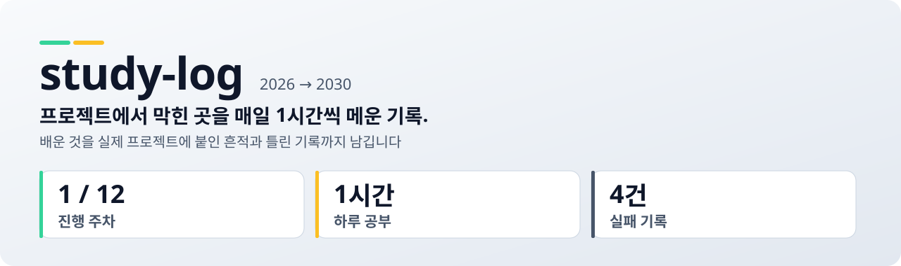
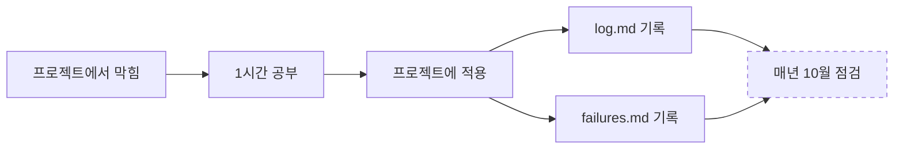

<picture>
  <source media="(prefers-color-scheme: dark)" srcset="assets/banner-dark.svg">
  
</picture>

<p align="center">
  
  
</p>

<p align="center">
  <a href="docs/failures.md"><b>실패 기록</b></a> ·
  <a href="evals/scores.md"><b>평가셋</b></a> ·
  <a href="#가장-어려웠던-문제-hardest-problem">가장 어려웠던 문제</a> ·
  <a href="docs/ai-usage.md">AI를 어떻게 썼나</a>
</p>

저는 번역 앱과 경매 분석 앱을 만들다가, 제가 짠 코드가 맞는지 판단할 실력이 모자란다는 걸 느꼈습니다. 그래서 하루 1시간씩 공부하고, 배운 것을 바로 그 프로젝트에 붙인 기록을 이 저장소에 남깁니다. 계획 초안과 페이지 코드는 AI(Claude)가 썼고, 무엇을 공부할지 고르고 숫자를 확인하는 건 제가 합니다.

공부 지도는 [`index.html`](index.html)에 있습니다. GitHub Pages로 열면 주차별 체크리스트가 동작합니다.

## 한눈에 (At a glance)

| 문제 | 방법 | 점수 | 다음 |
|---|---|---|---|
| 코드 판단력 부족 | 매일 1시간 | 아직 없음 | 예외처리 |

공부 저장소라 점수는 7주차(평가 단원)부터 생깁니다. 1주차 1~2일차(타입힌트, dataclass)를 끝냈고, 다음은 3일차 예외처리입니다. 문제와 제 답은 [`quiz/week1.md`](quiz/week1.md)에 있습니다.



점선인 "매년 10월 점검"은 아직 한 번도 하지 않은 단계입니다. 2027년 10월에 처음 합니다.

## 가장 어려웠던 문제 (Hardest problem)

**채용 통계 하나를 반대 방향으로 읽을 뻔했습니다.**

공부 지도를 만들면서 미국 AI 엔지니어 공고 분석에서 "경력 0~2년 2.5%"라는 숫자를 봤고, 처음엔 "신입을 받아주는 공고가 2.5%뿐"이라고 썼습니다. 다시 원문을 보니 경력 조건을 적은 공고 자체가 33%뿐이었습니다. 나머지 67%는 경력을 아예 안 적었으니, 제 문장은 신입 자리를 실제보다 훨씬 적게 보이게 만들었습니다.

그래서 문장을 "0~2년으로 명시한 공고 2.5%"로 바꾸고, 33%를 출처 옆에 같이 적었습니다. 오해 소지 문장 1개가 0개가 됐습니다. 이후로는 비율을 볼 때 "분모가 뭔지"부터 확인합니다.

## 1. 한 문장

프로젝트에서 막힌 부분을 매일 1시간씩 메우고, 배운 것을 실제 프로젝트에 적용한 흔적을 남깁니다.

## 2. 현재 점수

> [!WARNING]
> 아직 실행한 평가가 없습니다. 아래 진행도는 제가 직접 체크한 자기 기록입니다.

| 항목 | 값 | 날짜 |
|---|---|---|
| 진행 주차 | 1 / 12 (2일차까지) | 2026-10-10 |
| 누적 학습일 | 1일 (2회차) | 2026-10-10 |
| 1주차 문제 | ✅ 2 · △ 2 · ❌ 7 (자기 채점) | [`quiz/week1.md`](quiz/week1.md) |

## 3. 실패 로그 요약

| 실패 | 원인 | 전 → 후 |
|---|---|---|
| 경력 통계를 전체 비율처럼 읽음 | 분모(33%) 확인 안 함 | 오해 문장 1 → 0 |
| 인물 4명인데 "세 사람"이라고 씀 | 초안 수정 누락 | 불일치 1 → 0 |

전체는 [`docs/failures.md`](docs/failures.md)에 있습니다.

## 4. 자율성 표

| 작업 | 방식 | 이유 |
|---|---|---|
| 학습 계획 초안 | AI 제안 → 제가 확인 | 제 실력과 일정은 제가 제일 잘 압니다 |
| 연습 코드 | 제가 직접 작성 | 손으로 쳐야 배웁니다 |
| 코드 설명 | AI 제안 → 실행해서 확인 | 설명이 틀릴 수 있습니다 |
| 시장 수치 | 원 출처 확인 후 사용 | AI 요약은 위처럼 틀릴 수 있습니다 |

## 5. 버린 것

- **Notion:** 커밋 기록이 꾸준함의 증거가 되지 않아서 GitHub로 옮겼습니다.
- **주제별 저장소:** 쪼개면 하나하나가 빈약해 보여서 하나로 모았습니다.
- **CometKiwi:** 비상업 라이선스라 처음부터 뺐습니다.

자세한 이유는 [`docs/decisions.md`](docs/decisions.md)에 있습니다.

## 6. AI 사용 방식

공부 지도는 Claude Opus 5.5로 만들었습니다. 채용 데이터를 웹에서 찾고, legend-staff 스킬로 카파시·일리야·장쉐펑·나발의 시각을 추론해 정리했습니다. 인물 문장은 실제 인용이 아니라 추론입니다. 제가 확인한 것과 확인할 것은 [`docs/ai-usage.md`](docs/ai-usage.md)에 적었습니다.

## 7. 연도별 변화

| 연도 | 목표 | 결과 |
|---|---|---|
| 1년차 (2026.10~) | 파이썬 체력 + 검증 습관 | 진행 중 |
| 2년차 | 남이 쓸 수 있는 서비스 | |
| 3년차 | 딥러닝 직접 구현 | |
| 4년차 | 포트폴리오 정리·지원 | |

<details><summary><b>폴더 구조와 규칙</b></summary>

```
study-log/
├── index.html      공부 지도
├── log.md          매일 한 줄 기록
├── quiz/          주차별 문제 · 제 답 · 정답
├── assets/         배너
├── evals/          7주차부터
└── docs/           실패 · 결정 · AI 사용 기록
```

- API 키는 코드에 넣지 않습니다 (`.env` + `.gitignore`).
- 라이브러리와 모델은 상업 이용이 가능한 것만 씁니다.
</details>
